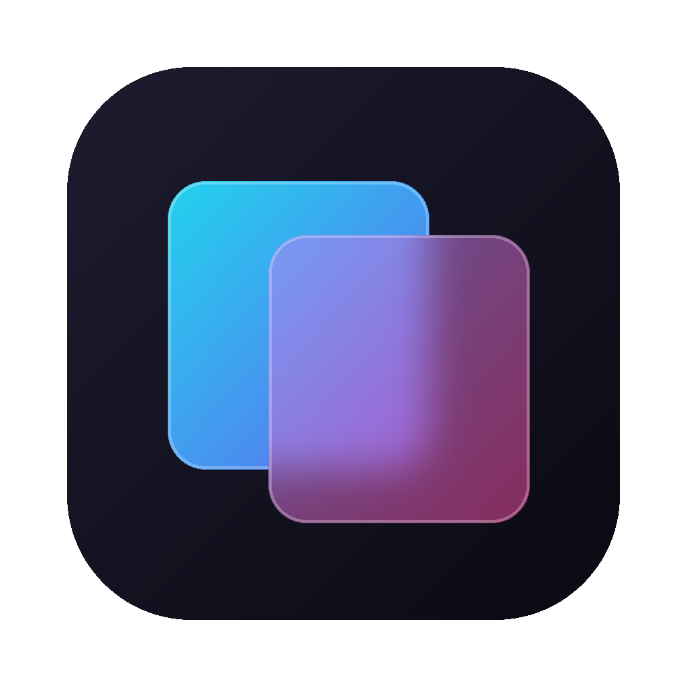

<p align="center">
  
</p>

<h1 align="center">Pane</h1>

<p align="center">A frosted-glass terminal multiplexer for macOS. A fork of <a href="https://github.com/muxy-app/muxy">Muxy</a>.</p>

## What Pane changes

Pane keeps Muxy's server, protocol, CLI and terminal engine. It changes the
desktop app:

- **Window glass.** The whole window is a frosted pane over the desktop. Turn
  it on or off and set its strength in **Settings → Appearance → Window glass**.
  It turns itself off under Reduce Transparency or Increase Contrast.
- **Overview.** The first tab of Home shows your day: a headline of tokens,
  commits and projects; a year of commits and of agent activity as heatmaps;
  streak, lines changed, sessions and time agents spent working; the models you
  used; your Claude plan limits; and the agent sessions you can pick up again.
  The dashboard button in the title bar reopens it. Switch between Today,
  Week and Month. It reads Claude Code and Codex logs and the Git history of
  your projects on this Mac, and nothing leaves the computer.
- **Claude plans.** The sidebar shows each Claude account's 5-hour and weekly
  limits and marks the one with the most room. `~/.claude` is `claude1`, and
  each `~/.claude-N` folder is `claudeN`; start one with
  `CLAUDE_CONFIG_DIR=~/.claude-2 claude`. Click an account to open Claude in a
  new tab with it. Pane reads each login on this Mac and asks Anthropic for its
  usage; it never renews a login, so an expired one waits until you run Claude
  with that account again. The usage address is not a documented API and may
  change.
- **Its own app.** Pane has its own name, icon, bundle identifier
  (`dev.hude06.pane`) and data folder (`~/Library/Application Support/Pane`,
  `Pane Dev` for local builds), so it runs beside an installed Muxy. Terminals
  in Pane get `MUXY_DIR`, so the `muxy` command in them reaches Pane's server.
- **No usage ping.** Muxy's daily install ping to `muxy.app` is removed.

Pane still uses Muxy's extension store and phone push relay at `muxy.app`. The
crates, the `muxy` command and messages about remote servers keep the Muxy
name, so upstream changes merge cleanly.

## Build

Requirements are in [`mise.toml`](mise.toml) and
[`rust-toolchain.toml`](rust-toolchain.toml): Rust 1.92 and Zig.

```bash
cargo run -p muxy-app          # run from source with the Pane Dev profile
./scripts/bundle-pane.sh       # build dist/Pane.app, signed for this Mac only
cargo xcheck && cargo xtest    # Clippy and the workspace tests, as CI runs them
```

Move `dist/Pane.app` to `/Applications` to keep it. A local build updates only
when you rebuild it.

## Keep up with Muxy

```bash
git fetch upstream
git switch main && git merge --ff-only upstream/main && git push origin main
git switch glass-frontend && git merge main
```

Conflicts are most likely in `README.md`, `PRIVACY.md`, the identity in
`crates/muxy-core/src/release.rs` and `dirs.rs`, and the app icon. Keep Pane's
side of those.

## Where the code is

| Part | Files |
| --- | --- |
| Window glass | `crates/muxy-ui/src/vibrancy.rs`, `crates/muxy-app/src/views/sidebar/vibrancy.rs`, `crates/muxy-app/src/model/preferences.rs` |
| Overview data | `crates/muxy-app-core/src/insights.rs`, `insights/agents.rs`, `insights/git.rs` |
| Overview screen | `crates/muxy-app/src/model/insights.rs`, `crates/muxy-app/src/views/overview.rs` |

Muxy's own guides are in [`docs/`](docs/) and at [muxy.app/docs](https://muxy.app/docs).

## License

[Apache 2.0](LICENSE), like Muxy. Code contributed to Muxy before its switch
from MIT remains under the MIT License; see [NOTICE](NOTICE). Pane is not made
or endorsed by the Muxy team.
